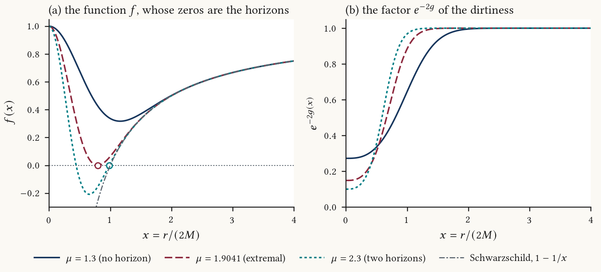

<!-- Author: Dr. Denys Dutykh (Mathematics Department, Khalifa University of Science and Technology, Abu Dhabi, UAE) -->

# dirtybh: quasinormal modes of noncommutative geometry-inspired dirty black holes



The two metric functions of the dirty black hole, as the assemblers write them, against the rescaled radius
x = r/(2M), for three values of the rescaled mass μ = M/√θ. Panel (a) shows f(x), whose zeros are the horizons: for
μ = 1.3 it has none; at the extremal value μ_e = 1.904119 the two horizons merge at x_e = 0.793658 (circle); for
μ = 2.3 the outer one, the event horizon, lies at x_h = 0.983286 (circle). Far from the centre f joins the
Schwarzschild function 1 − 1/x. Panel (b) shows the factor e^(−2g(x)) that multiplies the potential of the
perturbations: it equals e^(−μ) at the centre and 1 far from it, so that the dirtiness acts only where the smeared mass
has not yet been enclosed.

dirtybh holds the Maple and MATLAB material of a study of the quasinormal modes of the noncommutative geometry-inspired
dirty black hole of Nicolini and Spallucci: a static black hole whose point mass is smeared into a Gaussian
distribution of width √θ, which removes the central singularity and surrounds the hole with matter. It computes the
frequencies at which massless scalar (s = 0), electromagnetic (s = 1) and vector-type gravitational (s = 2)
perturbations ring and decay, for the non-extremal black hole and for the extremal one. Maple derives the perturbation
equation, compactifies the exterior of the black hole onto the interval −1 ⩽ y ⩽ 1, builds the quasinormal boundary
conditions into a factorisation of the solution, and assembles in multiprecision arithmetic the matrices of a Chebyshev
collocation; MATLAB, with the Advanpix Multiprecision Computing Toolbox, solves the resulting quadratic eigenvalue
problem and draws the spectra of several resolutions on one picture. The method and the results are those of the
article by Davide Batic, Denys Dutykh and Zeinabou Ahmed Babou in the Proceedings of the Royal Society A (2025), cited
below.

## The problem

In the rescaled radius x = r/(2M) and the rescaled mass μ = M/√θ, where θ is the noncommutativity parameter (an area),
the two metric functions are

```text
f(x) = 1 − erf(μx)/x + (2μ/√π) e^(−μ²x²),

g(x) = (μ/2) [ 1 − erf(μx) + (2μx/√π) e^(−μ²x²) ] = (μ/2) (1 − m(r)/M),
```

where m(r) is the mass enclosed within the radius r. With the time dependence e^(−iωt) and spherical harmonics of
degree ℓ ⩾ s, each perturbation obeys

```text
F d/dr( F dψ/dr ) + [ ω² − U(r) ] ψ = 0,          F = f e^(−g),

U(r) = f e^(−2g) [ ℓ(ℓ + 1)/r² + (1 − s²) f′/r − (1 − s) f g′/r ],
```

the prime being the derivative in r. The scalar potential (s = 0) is thus f e^(−2g) [ℓ(ℓ + 1)/r² + f′/r − f g′/r],
the electromagnetic one (s = 1) the centrifugal term f e^(−2g) ℓ(ℓ + 1)/r² alone, and the vector-type gravitational
one (s = 2) f e^(−2g) [ℓ(ℓ + 1)/r² − 3f′/r + f g′/r]; with g = 0 and f = 1 − 2M/r they become the potentials of the
Schwarzschild black hole. The dimensionless frequency is Ω = Mω, and Im Ω < 0 for a damped mode. The quasinormal modes
are the solutions ingoing at the event horizon and outgoing at infinity.

The horizons are the zeros of f, which do not involve g. Below the extremal mass μ_e = 1.904119076 there is none; at μ_e
the two horizons merge at x_e = 0.7936575898; above it there are two, and the codes work with the outer one, the event
horizon x_h, which tends to 1 as μ grows. At a simple horizon the tortoise coordinate diverges like a logarithm, at a
double one like a pole, so that the two cases need different factorisations, hence the two parallel sets of files.

The map y = 1 − 2x_h/x (x_e in the extremal case) sends the event horizon to y = −1 and infinity to y = +1. Once the
oscillating behaviour at both ends has been factored out, the remaining amplitude is regular on −1 ⩽ y ⩽ 1 and needs no
boundary condition; it is expanded in n Chebyshev polynomials and the equation is collocated at the n roots
y_i = cos((2i − 1)π/(2n)). The frequency enters the collocated equation at most quadratically, which gives

```text
( M0 + i Ω M1 + Ω² M2 ) a = 0
```

with three real n × n matrices; Maple exports `M1` without the factor i, which the driver applies when it solves the
problem as `polyeig(M0, mp('1i')*M1, M2)`. The derivations, the singularities of the coefficients at y = ±1 and their
limits are in the article and in the worksheets.

## Quick start

Each procedure writes its matrices into the folder `data/` of the path it is given, which must exist. In a terminal,
from the folder of the repository:

```bash
mkdir -p data
```

In Maple, read the procedure of the case and call it once per resolution; here the scalar perturbation with ℓ = 2 of
the non-extremal black hole of mass μ = 5:

```maple
read "matrixassembler_nonext.mpl":
MatrixAssembler(200, 100, 0, 2, 5.0, "/absolute/path/to/dirtybh"):
MatrixAssembler(200, 150, 0, 2, 5.0, "/absolute/path/to/dirtybh"):
MatrixAssembler(200, 200, 0, 2, 5.0, "/absolute/path/to/dirtybh"):
```

The arguments are the number of digits `d`, the number of Chebyshev modes `n` (the size of the matrices), the spin `s`,
the multipole `L` (that is ℓ), the rescaled mass `mu` and the path `p`. The procedure stops if ℓ < s, finds and prints
the event horizon (by `fsolve` from x = 0.98) and writes `data/M0_n.mat`, `data/M1_n.mat` and `data/M2_n.mat` in the
ASCII format of MATLAB. For the extremal black hole the mass is not an argument: `matrixassembler_ext.mpl` solves f = 0
and f′ = 0 for x_e and μ_e (from 0.79 and 1.90), prints both, and is called as
`MatrixAssembler(200, 100, 0, 2, "/absolute/path/to/dirtybh")`. The two procedures write files of the same names, so
each case is assembled and solved before the next one, or in a folder of its own.

Then, in MATLAB, make the line `addpath('/path/to/advanpix/')` of `chaseQNMs.m` point to the Advanpix toolbox, check
that its list of resolutions `list = [200, 150, 100]` matches the assembled ones, and run, from the folder of the
repository:

```matlab
chaseQNMs
```

For each resolution n the script sets the precision to n digits (`mp.Digits(n)`), reads the three matrices with
`mp.read` (which keeps all their digits, where `load` would round them to double precision), solves the eigenvalue
problem and finally draws all the spectra in the plane of Re ω and Im ω, one marker per resolution. The quasinormal
frequencies are the eigenvalues that stay in place from one resolution to the next; the others are artefacts of the
truncation. The number of digits `d` given to Maple must be at least the largest precision that MATLAB requests (200
with the default list), since it fixes the digits written to the files. The article overlaps n = 100, 150 and 200 and
reports values computed with 200 digits. Both stages take long at these sizes, the Maple one growing quickly with n, so
small resolutions are worth trying first.

## Contents

| File | Content |
|---|---|
| `01-NONEXTREME CASE_NCGDBHs-SUPPLEMENTAL MATERIAL.mw` | Maple 2022.1 worksheet: the derivation for the non-extremal black hole, from the perturbation equation and the ansatz to the singularities at y = ±1, the limits quoted in the article and, after a `restart` partway, the coefficients `L00hat` to `L22hat` that the assembler implements |
| `02-EXTREME CASE_NCDBHs-SUPPLEMENTAL MATERIAL.mw` | the same for the extremal black hole, ending with `L00ehat` to `L22ehat` |
| `Effective_Potential_in_r_non_extreme.mw`, `Effective_Potential_in_r_extreme.mw` | Maple 18 worksheets: the effective potential in the radius r and its change to the compactified variable; the first compares it with the potential of the noncommutative Schwarzschild black hole (`UNCSCHW`) |
| `matrixassembler_nonext.mpl`, `matrixassembler_ext.mpl` | the two Maple procedures `MatrixAssembler` |
| `chaseQNMs.m` | the MATLAB driver |
| `docs/figures/` | the script `plot_readme_figure.py` that draws the figure of this page from the two metric functions, with the style file beside it |

## Requirements

Maple 2022.1 or later for the two supplemental worksheets and Maple 18 or later for the two worksheets of the potential;
the procedures use only `LinearAlgebra`, `ChebyshevT`, `fsolve` and `ExportMatrix`. MATLAB with the Advanpix
Multiprecision Computing Toolbox (a commercial toolbox), whose `mp` class, `mp.Digits`, `mp.read` and multiprecision
`polyeig` the driver uses: the article computes with 200 digits so that rounding errors do not spoil the spectrum. The
figure of this page needs Python 3 with NumPy, SciPy and Matplotlib, and is redrawn from `docs/figures/` by
`python3 plot_readme_figure.py`.

## A note on the article

The line element (2.1) of the article, on page 4, prints its time component as −f(r) e^(−g(r)) dt². The intended line
element, from which equations (2.8) to (2.12) follow, carries the factor e^(−2g):

```text
ds² = −f(r) e^(−2g(r)) dt² + dr²/f(r) + r² dΩ²,
```

as in the dirty black hole of Nicolini and Spallucci (Classical and Quantum Gravity 27, 015010, 2010). Likewise, the
identification that follows equation (2.7), on page 5, should read e^(2Λ) = f e^(−2g). The codes use this line element,
through F = f e^(−g) and the factor f e^(−2g) of the potential, so that the computations and the results of the article
are not affected.

## How to cite

If you use this code, please cite the article:

D. Batic, D. Dutykh and Z. A. Babou, Quasi-normal modes of non-commutative geometry-inspired dirty black holes,
Proceedings of the Royal Society A: Mathematical, Physical and Engineering Sciences 481, 20250021 (2025).

https://doi.org/10.1098/rspa.2025.0021

```bibtex
@article{Batic2025b,
  author = {Batic, Davide and Dutykh, Denys and Babou, Zeinabou Ahmed},
  title = {Quasi-Normal Modes of Non-Commutative Geometry-Inspired Dirty Black Holes},
  journal = {Proceedings of the Royal Society A: Mathematical, Physical and Engineering Sciences},
  year = 2025,
  month = jul,
  volume = {481},
  number = {2318},
  pages = {20250021},
  doi = {10.1098/rspa.2025.0021},
  eprint = {2507.19107},
  archiveprefix = {arXiv}
}
```

The button "Cite this repository" in the right-hand column of this page gives the same reference, read from
`CITATION.cff`. The article is open access, and a free copy is also on arXiv:

https://arxiv.org/abs/2507.19107

## Licence

GNU Lesser General Public License, version 2.1 (see `LICENSE`).

## Authors

Davide Batic, Denys Dutykh and Zeinabou Ahmed Babou (Mathematics Department, Khalifa University of Science and
Technology, Abu Dhabi). The article is listed, with the other studies of quasinormal modes of the same group, in the
[Quasi-Normal Modes Hall of Fame](https://qnms.denys-dutykh.com/).

https://www.denys-dutykh.com/
